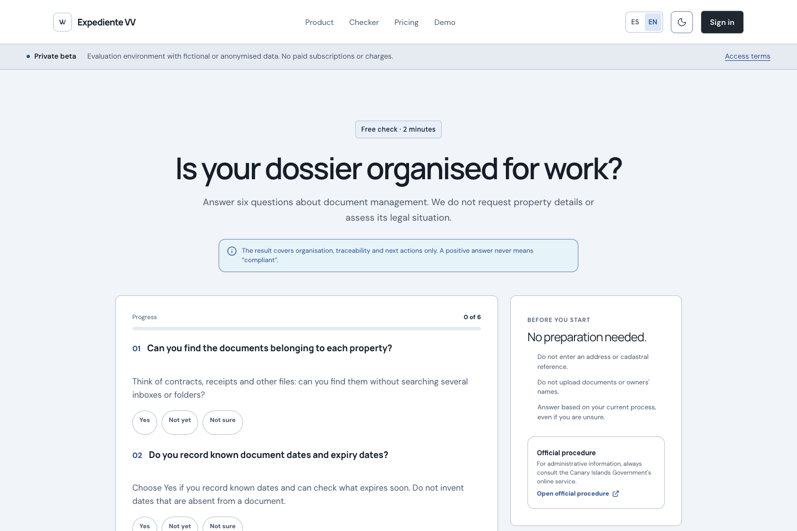
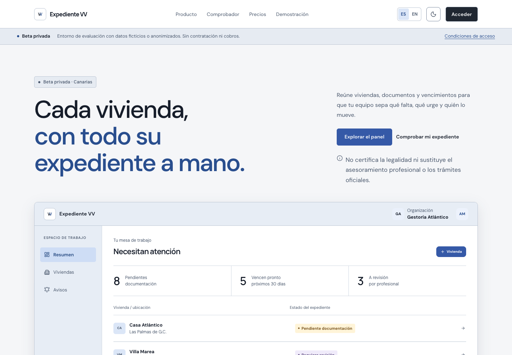
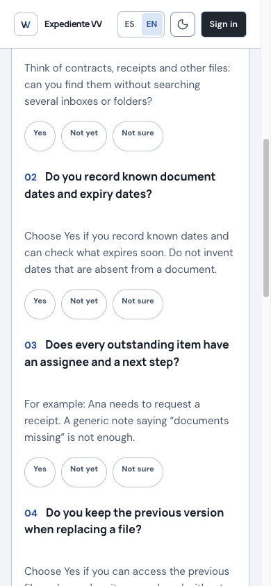

<p align="center">
  
</p>

# Expediente VV

A multi-tenant B2B workspace for Canary Islands holiday-rental dossiers, private documents, review checklists and traceable rule workflows.

## Preview



The public checker asks about document organization without collecting property records. It does not assess legal compliance.

<!-- Future screenshots: authenticated workspace with fictional demo data only.
Property workspace, document versions, review checklist.
Add verified captures here; do not insert broken image paths or real records. -->

[](https://github.com/Fernise/expediente-vv/actions/workflows/ci.yml)

**Technology:** React · TypeScript · Vinext/Vite · Cloudflare D1/R2 · Drizzle

[Overview](#what-it-does) · [Quick start](#quick-start) · [Architecture](docs/ARCHITECTURE.md) · [Verification](docs/VERIFICATION.md)

## What it does

For property professionals organizing holiday-rental documentation and review work in the Canary Islands.

- Organization workspaces, team roles and property-scoped permissions.
- Property dossiers, comments, document versions and review checklists.
- Versioned rules, independent professional review and traceable evaluations.
- Private export, retention/deletion workflows and recovery verification.

## Screenshots



The local landing page includes fictional dossier examples. Authenticated property-workspace captures remain pending.

<details>
<summary>Mobile view</summary>



The English public checker with no property details or answers entered.

</details>

## Project status

An anonymized-pilot MVP. Included rules and checklist states are drafts, not legal certification or professional advice. Real documents and live-data workflows require the outstanding security/provider checks; publication of this source does not enable them.

## Quick start

Requires Node.js 22.13+ and npm.

```sh
git clone https://github.com/Fernise/expediente-vv.git
cd expediente-vv
npm ci
npm run dev
```

Open the URL printed by Vite. Local Cloudflare emulation uses the logical `DB` and `DOCUMENTS` bindings declared in `.openai/hosting.json`. SQL schema and migrations are in `db/` and `drizzle/`.

The public configuration has no hosting account identifier or credentials. See [configuration](docs/CONFIGURATION.md) for local persistence and optional Gmail settings. Use fictional property records and your own isolated development resources.

## Verification

```sh
npm run check
npm run test:restore
npm run lint
npm run build
```

`npm run check` builds first, including type checking, then runs the automated regression suite. Some integration tests use local Miniflare resources. Recovery tests exercise fictional records and cryptographic handling; they are not a backup of a real deployment.

## Repository map

| Path | Responsibility |
| --- | --- |
| `app/` | Public pages, authenticated workspace and API routes |
| `lib/ and db/` | Domain rules, data access and security boundaries |
| `drizzle/` | Versioned database migrations |
| `worker/ and build/` | Scheduled worker and build-time hosting adapter source |
| `types/` | Cloudflare logical binding declarations |
| `tests/` | Permissions, tenancy, document, rule and recovery tests |

## Documentation

- [Verification record and limits](docs/VERIFICATION.md)
- [Architecture and data boundaries](docs/ARCHITECTURE.md)
- [Configuration](docs/CONFIGURATION.md)
- [Security policy](SECURITY.md)
- [Contribution guidance](CONTRIBUTING.md)
- [Third-party notices](THIRD_PARTY_NOTICES.md)

## License

All rights reserved. See [LICENSE](LICENSE).

Third-party libraries and assets retain their own licenses.
